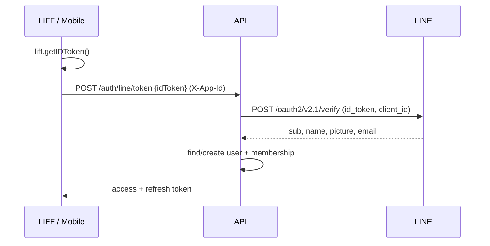
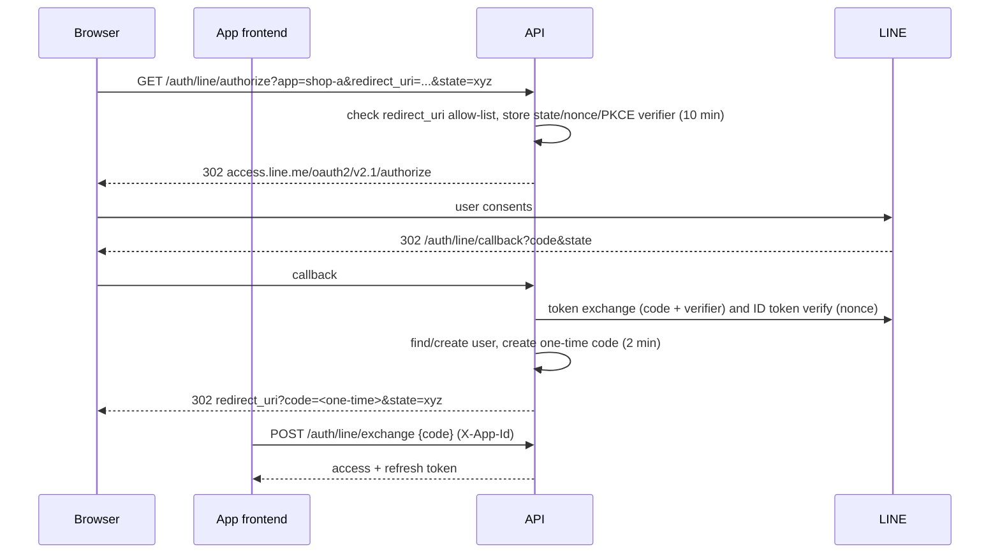
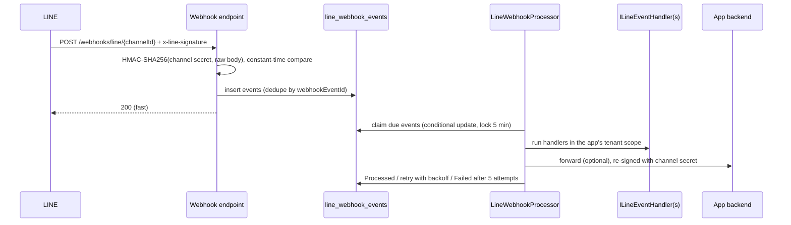

# D2D Central API — Architecture

One API that many client apps (web, mobile, LIFF, app backends) share for:

- **Authentication** — email/password and LINE Login, JWT access tokens + rotating refresh tokens
- **Multi app** — every app is a tenant with its own config, users' roles, LINE channels and API key
- **Multi DB** — a central *master* DB plus an optional *per-app* DB; each app can pick its own engine
  (SQL Server, PostgreSQL, MySQL, SQLite)
- **LINE** — LINE Login / LIFF, Messaging API webhooks and every Messaging API call for every app, with channel access tokens issued automatically

Stack: .NET 8, ASP.NET Core (controllers), EF Core 8.

---

## 1. High-level view

```mermaid
flowchart LR
    subgraph Clients
        W[Web / SPA]
        M[Mobile]
        L[LIFF app]
        B[App backend]
    end
    LINE[(LINE Platform)]

    subgraph API[D2D Central API]
        MW[Tenant resolution<br/>X-App-Id / JWT app_id]
        AUTH[Auth module]
        LL[LINE Login]
        WH[LINE webhook ingest]
        WK[Webhook processor<br/>BackgroundService]
        ADM[Admin API]
        MOD[App modules<br/>e.g. Notes]
    end

    MASTER[(Master DB<br/>apps, users, tokens,<br/>LINE config, inbox)]
    A1[(App A DB<br/>SQL Server)]
    A2[(App B DB<br/>PostgreSQL)]

    W & M & L -->|X-App-Id + Bearer| MW
    B -->|X-App-Id + X-Api-Key| MW
    MW --> AUTH & LL & MOD & ADM
    LINE -->|POST /webhooks/line/{channelId}| WH
    WH --> MASTER
    WK --> MASTER
    WK -->|forward, signed| B
    LL <--> LINE
    AUTH & LL & ADM --> MASTER
    MOD -->|ITenantDbContextFactory| A1 & A2
```

### Solution layout

| Project | Responsibility |
|---|---|
| `src/D2D.Core` | Entities, tenancy/LINE contracts, `ApiException`. No infrastructure dependencies. |
| `src/D2D.Infrastructure` | EF Core contexts, multi-DB factory, app registry/cache, token/auth services, LINE clients, webhook inbox + processor, admin service. |
| `src/D2D.Api` | ASP.NET Core host: auth schemes/policies, tenant middleware, rate limiting, controllers, Swagger. |
| `tests/D2D.Tests` | Unit tests (LINE signature, refresh-token rotation). |

---

## 2. Multi app (tenancy)

An **App** is a tenant: `Code` (public id, e.g. `shop-a`), `Name`, hashed API key, `IsActive`,
`AllowSelfRegistration`, redirect-URI allow-list, optional DB, LINE channels.

### How a request is tied to an app

`TenantResolutionMiddleware` runs after authentication, before authorization:

| Source | Used by |
|---|---|
| `app_id` claim in the JWT | Every authenticated user call |
| `X-App-Id: <code>` header | Login/register/refresh (no token yet), app backends |
| `?app=<code>` query | `GET /auth/line/authorize` only (browser navigation cannot send headers) |
| LINE channel id in the URL | Webhooks |
| `state` stored server-side | LINE Login callback |

Rules:
- Token for app A + header for app B → **403** (tokens cannot cross apps).
- Unknown app → 400, disabled app → 403.
- Services read the app via `ITenantContext.Required` (400 if none).

App configuration is read through `IAppRegistry`, cached in memory for 5 minutes, and invalidated
per app whenever the admin API changes it.

### Caller types

| Caller | Credentials | Policy |
|---|---|---|
| End user | `Authorization: Bearer <jwt>` (+ optional `X-App-Id`) | `AppUser` |
| App backend (server-to-server) | `X-App-Id` + `X-Api-Key` | `AppServer` |
| Platform admin | `X-Admin-Key` | `Admin` |

---

## 3. Multi DB

Two kinds of database:

1. **Master DB** (one, provider set in `MasterDb:Provider`) — shared platform data.
2. **App DB** (zero or one per app) — the app's own business data. Provider + encrypted connection
   string are stored in `app_databases`. Apps can use different engines.

```csharp
// Inside any request or webhook handler running for an app:
await using var db = await tenantDbFactory.CreateAsync<MyModuleDbContext>(ct);
```

`TenantDbContextFactory`:
- resolves the current app → its `DatabaseConfig` (decrypted, cached);
- builds `DbContextOptions` with the right provider (`DbProviderExtensions.UseProvider`) and caches them
  per *(app, context type, config version)*;
- EF Core keeps a separate model cache per provider, so the same `DbContext` type works on every engine.

Providers: `SqlServer`, `PostgreSql` (Npgsql), `MySql` (Pomelo, server version auto-detected once),
`Sqlite` (dev/test).

### Two ways an app uses its database

| | Who connects to the database | Use for |
|---|---|---|
| **Module inside D2D** | D2D, through `ITenantDbContextFactory` | small modules that live in the central API (e.g. the sample Notes module) |
| **App's own backend** | the app (payyet, joddaily, booksabuy…) with the connection string it gets from D2D | apps that keep their own code and schema (the normal case) |

For the second case D2D only stores the connection string (encrypted) and hands it to the owning app on request,
so the app has no connection string in its own config:

```
GET /api/v1/database/credentials    X-App-Id + X-Api-Key
→ { provider, connectionString, updatedAt }
```

- **Opt-in.** Register the database with `allowCredentialAccess=true`; otherwise 403, so a leaked app API key cannot read it.
- The app is identified by its key, so nothing is named in the request; each app can only read its own (other apps and
  end-user tokens get 404/401). Responses are `Cache-Control: no-store` and every read is logged (app code only, never the value).
- Fetch it at startup and when a connection fails; keep it in memory only. `updatedAt` changes when the string is replaced,
  so a new value reaches the app on its next fetch without redeploying it.
- Register with `verify=false` when D2D itself cannot reach the database (D2D otherwise tests the connection before
  saving). Leave `provision` off for an app's real database: it creates only the sample schema.
- Admin responses never contain the connection string.

### Master DB schema

```mermaid
erDiagram
    apps ||--o| app_databases : has
    apps ||--o{ app_redirect_uris : allows
    apps ||--o{ line_channels : owns
    apps ||--o{ user_apps : grants
    users ||--o{ user_apps : "member of"
    users ||--o{ external_logins : "linked to"
    users ||--o{ refresh_tokens : holds
    apps ||--o{ line_webhook_events : receives

    apps { guid Id PK; string Code UK; string Name; string ApiKeyHash; bool IsActive; bool AllowSelfRegistration }
    app_databases { guid AppId PK; string Provider; string ConnectionStringEncrypted; datetime UpdatedAt }
    line_channels { guid Id PK; guid AppId; string Type; string ChannelId UK; string ProviderId; string ChannelSecretEncrypted; string AccessTokenEncrypted; string WebhookForwardUrl }
    users { guid Id PK; string NormalizedEmail UK; string PasswordHash; string DisplayName; bool IsActive }
    user_apps { guid UserId PK; guid AppId PK; string Roles }
    external_logins { guid Id PK; guid UserId; string Provider; string ProviderScope; string ProviderKey; string ChannelId }
    refresh_tokens { guid Id PK; string TokenHash UK; guid FamilyId; guid AppId; datetime ExpiresAt; datetime RevokedAt }
    line_webhook_events { guid Id PK; string WebhookEventId UK; string Status; int Attempts; datetime NextAttemptAt; string Payload }
```

---

## 4. Authentication

### Identity model

- **Global user** (`users`) + **membership per app** (`user_apps`, roles scoped to that app).
  One person can use many apps with one account; roles never leak between apps.
- When a known user logs into a new app: membership is created automatically if the app has
  `AllowSelfRegistration`, otherwise 403.
- External identities live in `external_logins` (`Provider = "line"`, `ProviderScope` = LINE provider id,
  `ProviderKey` = LINE sub), unique per scope — see [LINE providers and users](#line-providers-and-users).

### Tokens

| Token | Format | Lifetime | Notes |
|---|---|---|---|
| Access | JWT **RS256** (header carries `kid`) | 15 min | Claims: `sub`, `name`, `email`, `app_id`, `app_code`, `role[]`, `jti` |
| Refresh | 48 random bytes, Base64Url | 30 days | Stored as SHA-256; bound to one app; **rotated on every use** |

### Validating tokens in an app's own backend

Tokens are signed with an RSA private key that only this API holds. Backends validate them with the
public keys published at `/.well-known/jwks.json` (OpenID discovery at `/.well-known/openid-configuration`),
so no secret is shared with payyet, joddaily or any other app.

```csharp
// payyet / joddaily / booksabuy backend (ASP.NET Core)
builder.Services.AddAuthentication("Bearer").AddJwtBearer(o =>
{
    o.Authority = "https://api.example.com";          // Server:PublicBaseUrl of the central API
    o.Audience = "d2d-apps";                       // Jwt:Audience
    o.MapInboundClaims = false;
    o.TokenValidationParameters.NameClaimType = "name";
    o.TokenValidationParameters.RoleClaimType = "role";
});
builder.Services.AddAuthorizationBuilder().AddPolicy("PayyetUser", p => p
    .RequireAuthenticatedUser()
    .RequireClaim("app_code", "payyet"));          // REQUIRED: a token for joddaily must not open payyet
```

Keys rotate without downtime: set a new key, move the old public key to `Jwt:RetiredPublicKeys`
(it stays in the JWKS until old access tokens, max 15 min, have expired), then remove it.
`Jwt:Issuer` must equal the issuer in the discovery document, so set it to the public base URL.

Refresh rotation with reuse detection: each sign-in starts a *family*. Presenting an already rotated
token revokes the whole family (likely theft). Rotation uses a conditional update so two concurrent
refreshes cannot both succeed. Logout revokes the family.

Passwords: ASP.NET Core Identity `PasswordHasher` (PBKDF2, auto-rehash). Unknown emails still run a hash
verification to keep timing uniform. Login endpoints are rate limited per IP + app.

### Email / password

```
POST /api/v1/auth/register   X-App-Id   {email,password,displayName} → tokens
POST /api/v1/auth/login      X-App-Id   {email,password}             → tokens
POST /api/v1/auth/refresh    X-App-Id   {refreshToken}               → tokens
POST /api/v1/auth/logout     X-App-Id   {refreshToken}               → 204 (this session only)
POST /api/v1/auth/logout-all Bearer                                  → 204 (every session in this app)
GET  /api/v1/auth/me         Bearer                                  → profile + roles + linked identities
DELETE /api/v1/auth/identities/{provider}/{scope}  Bearer            → unlink e.g. line/{lineProviderId}
```

Unlinking is refused (409) when it would remove the user's last way to sign in. Access tokens already
issued stay valid until they expire (15 min); only refresh tokens are revoked.

### Sign-in only through the app's backend (per app)

D2D has no login page: each app shows its own sign-in screen and sends the credentials to D2D. By default the screen
may call D2D directly (browser → D2D). Set `requireAppKeyForAuth=true` on an app and `register`, `login`, `refresh`,
`logout`, `auth/line/token` and `auth/line/exchange` only accept calls that also carry the app's `X-Api-Key`, i.e. the
app's **backend** forwards the credentials and users' passwords are only ever handled by a registered app. Everything
a signed-in user does with their own token (`me`, `logout-all`, linking, calling the app) is unaffected, and
`auth/line/authorize` stays public because it is only a browser redirect (the app's backend then exchanges the code).

### Checking a token with D2D (introspection)

```
POST /api/v1/auth/introspect   X-App-Id + X-Api-Key   {token}
→ { active: true, userId, displayName, email, roles, expiresAt }   or   { active: false }
```

An app can validate the JWT locally (fast, no call) or ask D2D. Asking reflects a disabled user, a removed membership and
role changes **immediately**, while local validation lags by the token lifetime (15 min). Use it for sensitive actions
(e.g. money in payyet) and local validation elsewhere. A token issued for another app, an expired or forged token is
`active: false` (no reason given). `roles` are the current ones from the database. A single `logout` does not make
access tokens already issued inactive; `logout-all` and `logout` revoke refresh tokens only.

---

## 5. LINE Login

Each app registers one or more **LINE Login channels** (`Type = Login`), each with the **LINE provider
id** it lives under (the id in the console URL `/console/provider/{id}`). The callback URL of this API
(`Line:LoginCallbackUrl`) must be added to every Login channel in the LINE Developers Console.

- **ID token flow:** the channel is picked from the token's `aud`, so one app can have several Login
  channels (e.g. several LIFF apps). A token from another app's channel is rejected.
- **Web flow:** `channel_id` query picks the channel; default is the app's first Login channel.

### LINE providers and users

LINE gives the same person the **same userId on every channel of one LINE provider** and a
**different userId on another provider**. Identities are therefore keyed by
`(provider id, LINE userId)`:

| Setup | Result |
|---|---|
| Apps under the same LINE provider (e.g. payyet + booksabuy on P1) | Same person → same user automatically |
| Apps under different LINE providers (e.g. payyet on P1, joddaily on P2) | Separate users until the person links them |

A channel's provider id cannot change after it is registered (LINE cannot move channels between
providers either).

### Flow A — LIFF / LINE SDK (ID token)



### Flow B — Web redirect (authorization code + PKCE)



Tokens never appear in a URL. The one-time code is bound to the app that started the flow.

### Apps without accounts (verify only)

An app that only needs to know *which LINE user is visiting* (no registration, no D2D login) lets its LIFF page
send `liff.getIDToken()` to the app's own backend, and the backend asks D2D to verify it:

```
POST /api/v1/auth/line/verify   X-App-Id + X-Api-Key   {idToken, nonce?}
→ { userId, providerId, channelId, displayName, pictureUrl, email, expiresAt }
```

This is the intended pattern for LIFF apps with no login at all: the LIFF page sends `liff.getIDToken()` with every
request (e.g. `Authorization: Bearer <idToken>`), and the app's backend calls this endpoint to learn who it is.
D2D remembers a verified token until it expires (at most 5 minutes, per channel), so calling it on every request
costs no extra call to LINE. When the token has expired (`expiresAt` passed, ID tokens last about an hour) the verify
call fails with 401: the LIFF page should call `liff.login()` again to get a fresh one. A backend may also verify
the ID token itself against LINE's `/oauth2/v2.1/verify` using only the Login channel id; this endpoint just adds the
app/channel ownership check and the cache.

Without verification the `userId` a browser sends is just a claim anyone can forge, so use it only for public data.

Nothing is stored and no tokens are issued; the app keeps `userId` (stable per LINE provider) as its own key.
Only the app's backend may call it (a userId sent by the browser can be forged), the token must belong to a Login
channel of the calling app, and LINE checks signature, expiry and audience. `email` is present only if the channel
has the email permission and the user allowed it.

### Account linking (across LINE providers)

A LINE login is never auto-linked to an existing account by email (that would let whoever controls a
LINE account with that email take over the account). The LINE email is copied only if no other user
owns it. Linking is explicit and requires the user to be signed in (Bearer):

| Endpoint | Use when |
|---|---|
| `POST /api/v1/auth/line/link {idToken}` | Client already has an ID token from any registered Login channel |
| `POST /api/v1/auth/line/link/start {channelId, redirectUri, state}` → `{authorizeUrl}` | Web: browser goes through LINE Login on the other provider's channel and returns to `redirectUri?linked=line&state=…` (or `error=link_failed`) |

Example: Alice uses payyet (P1). In payyet she taps "Connect joddaily", the app calls `link/start` with
joddaily's Login channel; after consenting, her P2 identity is attached to the same user, and later
joddaily logins resolve to that user.

Rules: one LINE account per LINE provider per user; a LINE identity that already belongs to another
user returns 409 (merging two existing users is not supported).

---

## 6. LINE Messaging webhook

Each **Messaging API channel** is configured in LINE with webhook URL
`https://<api-host>/webhooks/line/{channelId}`.



Design points:
- **Inbox pattern** — the endpoint only verifies and stores, so LINE always gets a quick 200.
- **Idempotent** — unique `WebhookEventId` drops LINE redeliveries.
- **Multi-instance safe** — events are claimed with a conditional `UPDATE`; a crashed worker's lock expires.
- **Retries** — exponential backoff (30 s → 4 min), `Failed` after 5 attempts with `LastError` kept.
- **Two ways to consume events**
  1. In-process: implement `ILineEventHandler` (`CanHandle` can filter by app/event type). Handlers run
     inside the app's tenant scope, so `ITenantDbContextFactory` points to that app's DB.
  2. Forwarding: set `WebhookForwardUrl` on the channel. The app backend receives LINE's own envelope
     signed with the channel secret, so it can verify it with the official LINE SDK unchanged.
- Handlers and forwarding are retried together, so **handlers must be idempotent**.

### Messaging API (for app backends)

All endpoints need `X-App-Id` + `X-Api-Key`. Optional headers:
`X-Line-Channel-Id` picks one of the app's Messaging channels (default: the first);
`X-Line-Retry-Key` (UUID) is passed to LINE so a retried send is not delivered twice
(generated automatically for push/multicast/broadcast/narrowcast when omitted).
LINE's `X-Line-Request-Id` is returned on every response.

| Method | Path | LINE API |
|---|---|---|
| POST | `/api/v1/line/push` `{to, messages[1..5]}` | Push |
| POST | `/api/v1/line/reply` `{replyToken, messages[1..5]}` | Reply |
| POST | `/api/v1/line/multicast` `{to[1..500], messages}` | Multicast |
| POST | `/api/v1/line/broadcast` `{messages}` | Broadcast |
| POST | `/api/v1/line/narrowcast` (LINE's body as-is) → `{requestId}` | Narrowcast |
| GET | `/api/v1/line/narrowcast/{requestId}/progress` | Narrowcast progress |
| GET | `/api/v1/line/profile/{userId}` | Get profile |
| GET | `/api/v1/line/bot-info` | Bot info |
| GET/POST/PUT/DELETE | `/api/v1/line/proxy/{v2/bot/...}` | **Any other Messaging API endpoint**: rich menus (incl. image upload), message content download, audiences, insights, quota… |

Errors in the caller's request keep LINE's status (400/404/409/429); token or LINE-side failures
become 502. The proxy returns LINE's status, content type and body unchanged, routes binary
endpoints (`message/{id}/content`, `richmenu/{id}/content`, audience file upload) to
`api-data.line.me`, and only accepts `v2/bot/...` paths.

In-process handlers use `ILineMessagingClient` (push, reply, multicast, broadcast, narrowcast, profile).

### Channel access tokens

Each Messaging channel has a `tokenMode`; the API obtains tokens itself:

| Mode | Setup | Behaviour |
|---|---|---|
| `Static` | Paste the long-lived token from the console | Used as is |
| `Stateless` (default when no token is given) | Nothing beyond channel id + secret | 15-minute token issued on demand (`/oauth2/v3/token`), cached per instance |
| `JwtAssertion` | Register a public key in the console; give the API the private key (JWK) and its `kid` | v2.1 token (7 days) issued with a signed JWT, **stored in the master DB** so all instances share it, renewed a day before expiry (stays far below LINE's 30-active-token limit) |

If LINE rejects an issued token (401), it is dropped and the call retried once with a fresh token.
`POST /api/v1/admin/apps/{id}/line-channels/{channelId}/verify` proves the setup by calling bot info.

### Keys for apps that call LINE themselves (opt-in)

An app whose backend talks to LINE directly does not need to store any LINE key: it sends the channel id and
D2D answers from the database.

```
GET /api/v1/line/channels/{channelId}/credentials     X-App-Id + X-Api-Key
→ { channelId, providerId, type, tokenMode, channelSecret, accessToken, accessTokenExpiresAt }
```

- `accessToken` is a token that works now (Messaging channels): the stored one for `Static`, otherwise one D2D
  issued and renews itself. `accessTokenExpiresAt` is null for `Static`. Cache it in memory and fetch again when
  it is within a minute of expiring (a returned token has at least 2 minutes left for `Stateless`, 1 day for `JwtAssertion`).
  Login channels return only `channelSecret`.
- `channelSecret` lets the app verify webhook signatures or exchange Login codes itself.
- The v2.1 signing key (`assertionPrivateKey`) is never returned.
- **Off by default.** Register the channel with `allowCredentialAccess=true` to enable it. Without it the
  endpoint returns 403, so a leaked app API key cannot read secrets from channels that did not opt in.
- Only the owning app can read a channel (other apps and end-user tokens get 404/401); responses are
  `Cache-Control: no-store`, and every read is logged with the app code and channel id (never the values).
- The app must keep the keys in memory only: never log them, never send them to a browser. Rotate the app's API
  key (`POST .../api-key/rotate`) and the channel secret in the LINE console if a backend is compromised.

---

## 7. Admin console and admin API

### The console (`/admin/`)

A web page served by D2D itself (static files in `wwwroot/admin`, no build step, no external scripts) for running the
whole platform: dashboard, apps (settings, members and roles, LINE channels, database), all users, the LINE webhook
inbox (with retry), admin accounts and the audit log. Anything the admin API can do can be done there.

| | |
|---|---|
| **First run** | `/admin/` shows a setup form while no admin exists. Proof of ownership is the `Admin:ApiKey` from the server configuration (used once, not stored). |
| **Roles** | `Admin` can view and change everything. `Viewer` can only look: the buttons are hidden and the server refuses every change. |
| **Sign-in** | Email + password. The access token (JWT, 15 min, own audience `d2d-admin`) is kept in memory only. The session is an **HttpOnly, SameSite=Strict cookie** (path `/api/v1/admin/auth`) that JavaScript cannot read; refreshing rotates it, and replaying an old one ends the session. Refresh and logout also need the `X-Requested-With: d2d-admin` header. |
| **Separate from app users** | Admins are their own accounts (`admin_users`): no app user can ever become an admin, and app tokens do not open the admin API or the other way round. |
| **Break-glass** | The static `X-Admin-Key` still works on the admin API for scripts and as a way back in. |
| **Audit log** | Every successful change (anything but GET) is recorded with who (email, or "admin-key"), route, time and IP. Request bodies are never stored, so no secret ends up in the log. |
| **Browser hardening** | `/admin` responses carry a strict CSP (no inline script or style, same-origin only), `X-Frame-Options: DENY`, `nosniff` and no-referrer. All values shown are HTML-escaped. |

`Admin` and `Viewer` accounts are managed on the console's *Admins* page (or `/api/v1/admin/admins`). Nobody can demote or
disable themselves, and the last active `Admin` cannot be removed. Demoting, disabling or resetting the password of an
admin ends their open sessions.

### Admin API

Reading needs any admin (key, `Admin` or `Viewer`); changing needs `Admin` (or the key). Used by the console, and
usable directly with `X-Admin-Key` or `Authorization: Bearer <admin access token>`.

| Method | Path | Purpose |
|---|---|---|
| POST | `/api/v1/admin/auth/login` | Admin sign-in → access token + session cookie |
| POST | `/api/v1/admin/auth/refresh`, `/logout` | Rotate / end the session (cookie + `X-Requested-With`) |
| GET | `/api/v1/admin/auth/status`, `/me` | Whether first-run setup is needed; who I am |
| POST | `/api/v1/admin/auth/password` | Change my password (ends my sessions) |
| GET/POST/PUT | `/api/v1/admin/admins` (+ `/{id}/password`) | Admin accounts |
| GET | `/api/v1/admin/stats` | Overview numbers and per-app usage |
| GET | `/api/v1/admin/users`, `/users/{id}` | Every user, with apps, roles, linked accounts, open sessions |
| POST | `/api/v1/admin/users/{id}/password`, `/revoke-sessions` | Set a user's password; sign them out everywhere |
| GET | `/api/v1/admin/webhook-events`, `/{id}` | LINE inbox (filter by status, app, text); one event with its payload |
| POST | `/api/v1/admin/webhook-events/{id}/retry` | Put a failed event back in the queue |
| GET | `/api/v1/admin/audit` | Audit trail |
| DELETE | `/api/v1/admin/apps/{id}` | Delete an app with its channels, sessions and inbox (users stay) |

### Apps, channels and members (admin)


| Method | Path | Purpose |
|---|---|---|
| GET | `/api/v1/admin/apps` | List apps |
| POST | `/api/v1/admin/apps` | Register app → returns API key **once** |
| GET/PUT | `/api/v1/admin/apps/{id}` | Read / update name, active, self-registration, redirect URIs, `requireAppKeyForAuth` (omit on update to keep it) |
| POST | `/api/v1/admin/apps/{id}/api-key/rotate` | New API key |
| PUT | `/api/v1/admin/apps/{id}/database` | Set app DB `{provider, connectionString, provision?, allowCredentialAccess?, verify?}`; connection is tested first unless `verify=false` |
| PUT | `/api/v1/admin/apps/{id}/line-channels` | Add/update LINE channel `{type, channelId, providerId, channelSecret, accessToken?, webhookForwardUrl?}`; providerId is fixed once set |
| POST | `/api/v1/admin/apps/{id}/line-channels/{channelId}/verify` | Obtain a token and call LINE bot info |
| DELETE | `/api/v1/admin/apps/{id}/line-channels/{channelId}` | Remove channel |
| GET | `/api/v1/admin/apps/{id}/members?search=&skip=&take=` | List members (roles, login methods, last login) |
| POST | `/api/v1/admin/apps/{id}/members` | Add a member `{email, displayName?, password?, roles?}`; unknown email creates the user (password required) |
| PUT | `/api/v1/admin/apps/{id}/members/{userId}` | Set roles `{roles}` |
| DELETE | `/api/v1/admin/apps/{id}/members/{userId}` | Remove member and end their sessions in that app |
| PUT | `/api/v1/admin/users/{userId}/active` | `{isActive}`: disable/enable a user in every app (disabling ends all sessions) |

### Members API for an app's own backend (`X-App-Id` + `X-Api-Key`)

`GET/POST /api/v1/members`, `PUT/DELETE /api/v1/members/{userId}` — the same operations, limited to the
calling app. Use it to provision accounts for apps with `allowSelfRegistration=false` and to assign roles
from the app's own admin screen without holding the platform admin key.

Roles are lowercase names (`a-z 0-9 _ : . -`, up to 32 characters, at most 10); `super_admin` and
`app_server` are reserved. A role change appears in the next access token (refresh), not in tokens already issued.

Line channel body also takes `tokenMode` (`Static` / `Stateless` / `JwtAssertion`), `assertionKeyId`,
`assertionPrivateKey` (JWK JSON) — see [Channel access tokens](#channel-access-tokens) — and
`allowCredentialAccess` (default `false`) — see [Keys for apps that call LINE themselves](#keys-for-apps-that-call-line-themselves-opt-in).
Responses from the admin API never contain secrets or tokens, only whether a token exists.

---

## 8. Security

| Concern | Measure |
|---|---|
| Stored secrets (connection strings, channel secrets, access tokens) | Encrypted with ASP.NET Core Data Protection (`ISecretProtector`) |
| API keys, refresh tokens | Only SHA-256 hashes stored; constant-time comparison |
| Cross-app token use | `app_id` claim must match `X-App-Id`; refresh tokens bound to app; backends must require their own `app_code` |
| Token forgery | RS256 only (HS256 / algorithm confusion rejected); private key never leaves this API, backends hold public keys only |
| LINE keys and connection strings leaving D2D | Never in admin responses; only to the owning app's backend, per channel / per database opt-in, no-store, read log |
| Webhook spoofing | `x-line-signature` HMAC check on raw bytes; body limit 1 MB |
| Open redirect | Redirect URIs must be in the app's allow-list (exact match) |
| CSRF / code injection in LINE Login | `state` (server-side, single use), `nonce`, PKCE S256 |
| Brute force | Fixed-window rate limit on auth endpoints (20/min per IP + app) |
| Errors | RFC 7807 problem details; expected errors are not logged as unhandled |
| Admin console | Own accounts and audience, HttpOnly SameSite=Strict session cookie, access token in memory, strict CSP, audit log, read-only role, brute-force rate limit on sign-in |

---

## 9. Configuration

| Key | Meaning |
|---|---|
| `MasterDb:Provider` / `ConnectionString` / `AutoCreate` | Master DB; `AutoCreate` = `EnsureCreated` on startup (dev only) |
| `Server:PublicBaseUrl` | Public URL incl. IIS application path (e.g. `https://api.example.com`); used in discovery and admin `webhookUrl` |
| `Jwt:Issuer` / `Audience` / `AccessTokenMinutes` / `RefreshTokenDays` | Tokens (`Issuer` = public base URL) |
| `Jwt:AdminAudience` / `AdminAccessTokenMinutes` / `AdminSessionHours` | Admin console tokens (default `d2d-admin`, 15 min, session ends 12 h after the last refresh) |
| `Jwt:PrivateKeyPem` or `Jwt:PrivateKeyPath` | RS256 signing key; if neither is set a key is generated at `{DataProtection:KeysPath}/jwt-signing.pem` |
| `Jwt:RetiredPublicKeys` | PEM public keys of rotated-out signing keys |
| `Line:LoginCallbackUrl` / `Scope` / `AuthStateMinutes` | LINE Login |
| `Admin:ApiKey` | Admin API key (empty = admin API disabled) |
| `DataProtection:KeysPath` / `ProtectWithDpapi` | Key ring location; Windows-only encryption of the key ring at rest |
| `Cors:AllowedOrigins` | Browser origins |
| `RateLimit:AuthPermitPerMinute` | Login/register/refresh attempts per IP + app per minute (default 20) |
| `Maintenance:Enabled` / `IntervalMinutes` / `ProcessedWebhookRetentionDays` / `FailedWebhookRetentionDays` / `ExpiredTokenGraceDays` | Hourly cleanup of old webhook events (14 / 90 days) and expired refresh tokens (revoked tokens are kept until they expire, so replay detection keeps working) |

Production secrets go in `appsettings.Production.json` on the server (never in git) or environment
variables (e.g. `MasterDb__ConnectionString`), never in `appsettings.json`. The JWT signing key file is
stored unencrypted: keep it outside the web root with file permissions limited to the app identity.
See [DEPLOYMENT.md](DEPLOYMENT.md) for Plesk/IIS.

---

## 10. Production checklist / next steps

Not done in the scaffold — required before production:

1. **Migrations** — replace `EnsureCreated` with EF Core migrations. Migrations are provider-specific:
   keep one migrations assembly per provider (`D2D.Migrations.SqlServer`, `.PostgreSql`, `.MySql`) for
   the master DB and for each app module.
2. **Data Protection key ring** — share it across instances and protect it at rest
   (Azure Key Vault / AWS KMS / certificate). Losing it makes stored secrets unreadable.
3. **Distributed cache** — swap `AddDistributedMemoryCache` for Redis (LINE Login state/one-time codes),
   use atomic `GETDEL` for single-use codes.
4. **JWT key at rest** — the RS256 private key is a plain PEM file; move it to a vault / certificate store
   when one is available.
5. **Forwarded headers** behind a load balancer other than IIS (real client IP for rate limiting and audit).
6. **Account features** — email verification and password reset (need an SMTP/email provider), account
   lockout after repeated failures, letting a LINE-only user set a password, merging two existing users.
7. **Per-app CORS** (origins from each app's config instead of one global list).
8. **Observability** — structured logs (Serilog/OpenTelemetry), a dashboard or admin endpoint for the webhook
   inbox (`Failed` events), audit log of admin actions.
9. **Importing existing apps** — move payyet/joddaily webhooks to `/webhooks/line/{channelId}` (use
   `webhookForwardUrl` to keep their current bot backends) and import their existing users/identities.
